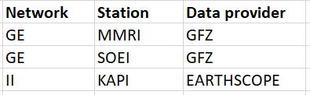

# Data Description

This project uses seismic waveform data from 61 earthquake events.

The original waveform files are stored in MiniSEED (.mseed) format and were used for waveform preprocessing, filtering, and STA/LTA detection.

Due to repository size limitations, only a small number of raw waveform files are included in this repository.

# Data Information

Earthquake events were retrieved from the USGS Earthquake Catalog using the ObsPy FDSN client and covered the period from January 1 to March 31, 2024.

The following selection criteria were applied:
* Number of earthquake events: 61
* Data source: USGS Earthquake Catalog
* Time period: January 1 -  March 31, 2024
* Latitude range: −11.379° to −3.980°
* Longitude range: 115.269° to 128.188°

Events were assigned sequential identifiers (EQ001, EQ002, etc) for waveform processing.

# Seismic Waveform Data

Waveform data were retrieved through the FDSN web services using ObsPy, with GFZ and EarthScope serving as waveform data providers.

Three candidate seismic stations were initially selected based on their proximity to the study region and earthquake events.

The initial station selection was intended to obtain waveform recordings from multiple stations. However, waveform availability varied among the selected stations. The availability-checking procedure was therefore used to identify stations with accessible recordings for the selected earthquake events.

The waveform retrieval was configured to request vertical-component broadband data (BHZ), covering a time window from 60 seconds before to 300 seconds after each earthquake origin time.

* Data format: MiniSEED
* Channel: BHZ
* Requested time window: -60 s to 300 s relative to origin time
* Waveform duration requested: 360 s
* Waveform providers: GFZ and EarthScope

Waveform availability, sampling rates, station coordinates, and event-to-station distances were recorded in a metadata table (waveform_availability.csv).

Due to incomplete waveform availability at the initially selected stations, the subsequent STA/LTA analysis was conducted using the available waveform recordings from a single station (SOEI).

All waveform files are not included in this repository. The waveform metadata and data retrieval procedures are documented to support reproducibility.

